<div align="center">

# LAN-portaal

**Brackets, klassementen, zitplan en prijzen: alles live op je beamer.**


</div>

Met dit portaal organiseer je een complete LAN-party: edities (events), toernooien vanuit templates,
live brackets en klassementen, games, teams, spelers, zitplan, prijzen/shop en Discord-meldingen.
Alleen admins melden aan; het publiek ziet alles live bijwerken. Handig op een beamer in de zaal.

> Het portaal werkt **volledig offline** op het LAN-netwerk: lettertypes en alle bestanden worden lokaal gehost.

---

## Wat kan het?

| Onderdeel | Omschrijving |
|---|---|
| **Toernooien** | Knock-out, double elimination, competitie, poules, Swiss, puntentoernooi, scorebord en LAN-rondes (groepen of zaal) |
| **Check-in en import** | Spelers importeren uit een `.xlsx` of `.csv` (bv. de export van Microsoft Forms, zonder externe bibliotheek), inchecken aan de deur, namen vrijgeven |
| **Mijn ronde** | Spelers kiezen hun gamertag (zonder wachtwoord) en zien groep, host, room en uitslag op hun telefoon |
| **Klassement** | Algemeen klassement over alle rondes, met een tv-weergave (`#/klassement?tv=1`) |
| **Live** | Elke uitslag verschijnt meteen bij iedereen (Server-Sent Events) |
| **Events** | Elke editie heeft eigen toernooien, zitplan en prijzen, met een aftelling op de startpagina |
| **Zitplan** | Zones als raster of als tafels met twee kanten; spelers kiezen zelf hun plaats |
| **Prijzen & shop** | Prijzenlijst per event |
| **Plugins** | Discord-embeds en algemene webhooks |
| **Thema's** | VIVES, Gamer, Halloween en Pasen met animaties en zwevende sprites; eigen thema's toevoegen zonder code |
| **PWA** | Installeerbaar op telefoon of desktop |

---

## Zo ziet het eruit

### Publieke site

| Startpagina met aftelling | Live bracket |
|---|---|
| 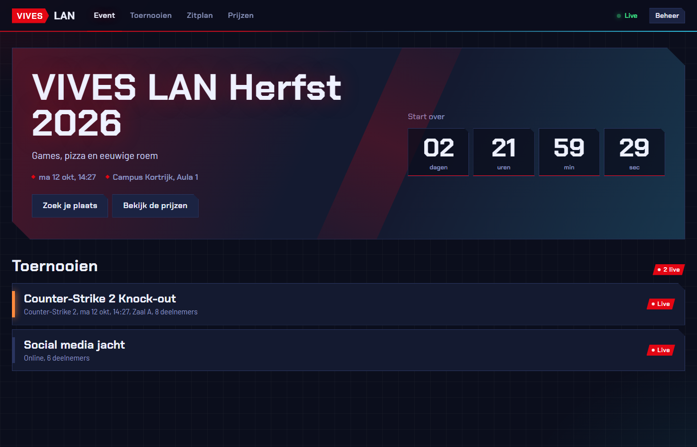 | 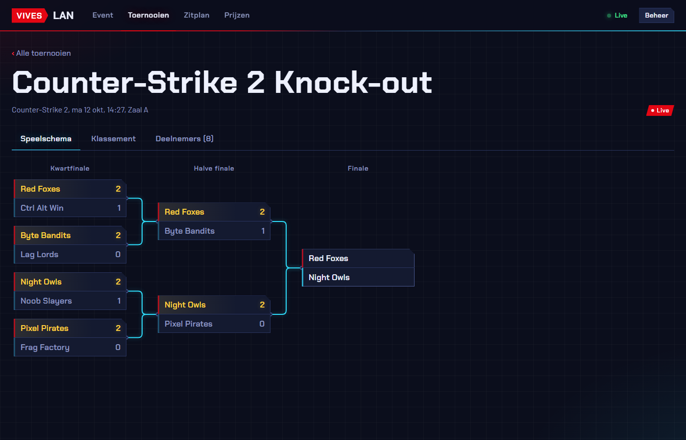 |

| Klassement van een scorebord |
|---|
| 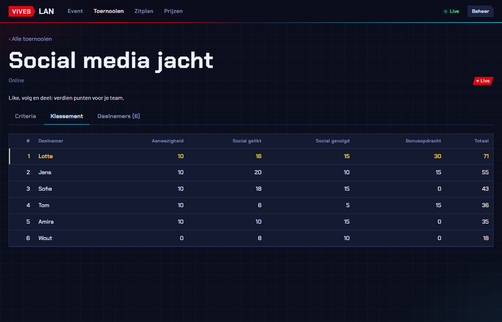 |

### Beheer

| Punten toekennen | Criteria beheren |
|---|---|
| 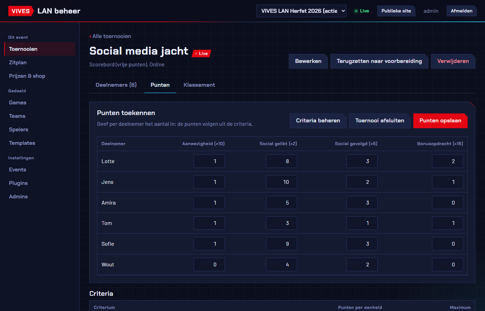 | 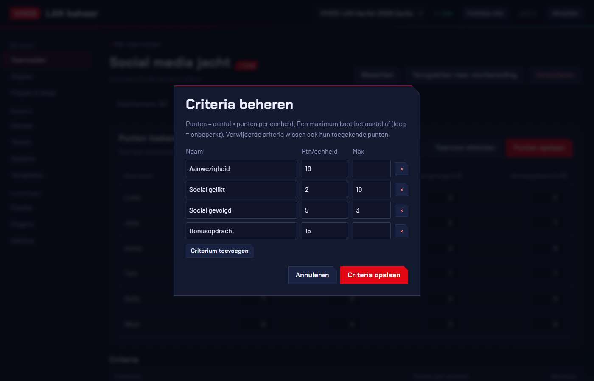 |

---

## Snel starten (Docker)

```bash
cp .env.example .env        # vul ADMIN_PASSWORD en JWT_SECRET in
docker compose up -d --build
```

| Wat | Waar |
|---|---|
| Publieke site | `http://<server>:3000` |
| Beheer | `http://<server>:3000/admin` (of de knop **Beheer** rechtsboven) |
| Data | volume `lan-data` (`/app/data`, JSON-bestanden). Back-up = die map kopiëren |

Het eerste admin-account komt uit `.env`. Je beheert admins daarna onder **Beheer → Admins**.

### Instellingen (`.env`)

| Variabele | Betekenis |
|---|---|
| `PORT` | Poort waarop het portaal luistert (standaard `3000`) |
| `ADMIN_USERNAME` / `ADMIN_PASSWORD` | Eerste admin, enkel aangemaakt als er nog geen admins bestaan |
| `JWT_SECRET` | Lange willekeurige string, bv. `openssl rand -hex 32` |
| `DATA_DIR` | Map waar de JSON-data staat |
| `COOKIE_SECURE` | `true` als het portaal achter HTTPS draait |
| `PUBLIC_URL` | Publiek adres, voor links in Discord-berichten (optioneel) |
| `SITE_MARK` / `SITE_NAME` | Standaard merknaam in de topbalk (standaard `VIVES` en `LAN`). In de admin onder **Site** pas je ze aan |
| `THEMES_DIR` | Map met eigen thema's (standaard `./custom-themes`; in Docker al gekoppeld) |

> Achter een reverse proxy met HTTPS: zet `COOKIE_SECURE=true` en laat de proxy `/api/live`
> niet bufferen, bv. in nginx `proxy_buffering off;`.

---

## Lokaal ontwikkelen

```bash
npm install
ADMIN_PASSWORD=geheim123 npm run dev
npm test                    # test de engine, LAN-rondes, spelers, klassement en zitplan
```

---

## Thema's

De site heeft vier ingebouwde thema's, met animaties en zwevende sprites:

| Thema | Sfeer |
|---|---|
| **VIVES** | De standaardstijl: VIVES-rood tegen cyaan |
| **Gamer** | Neon, synthwave-raster, scanlines, glitch, en knipogen naar klassieke games |
| **Halloween** | Horror: bloedmaan, druipend bloed, klauwsporen, mist en rode ogen in het donker |
| **Pasen** | Licht en zacht: pastel, konijntjes, vlinders, eieren en bloemblaadjes |

| Gamer | Halloween |
|---|---|
| 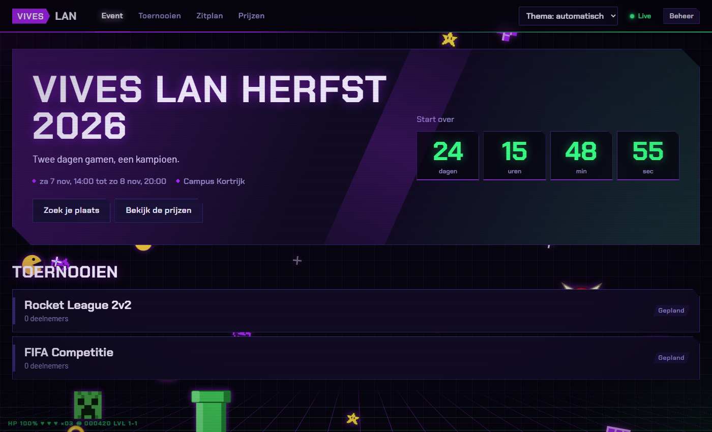 | 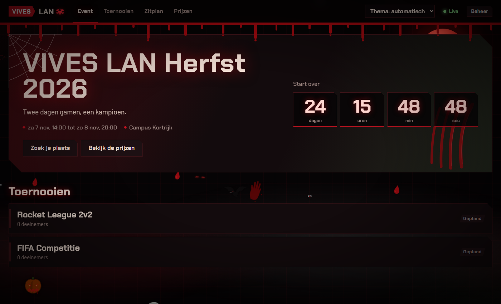 |

| Pasen | VIVES (standaard) |
|---|---|
| 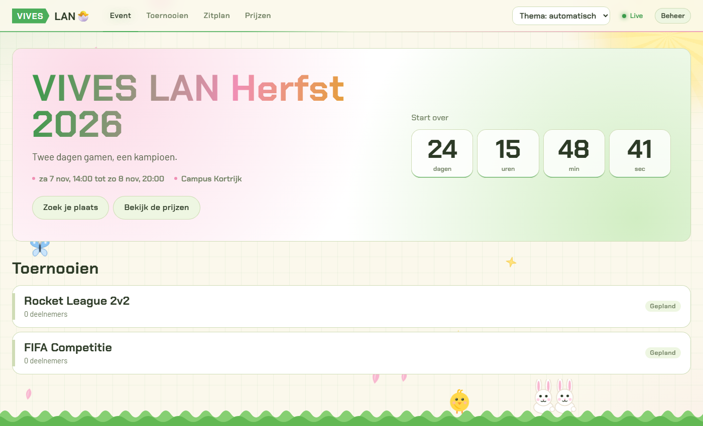 | 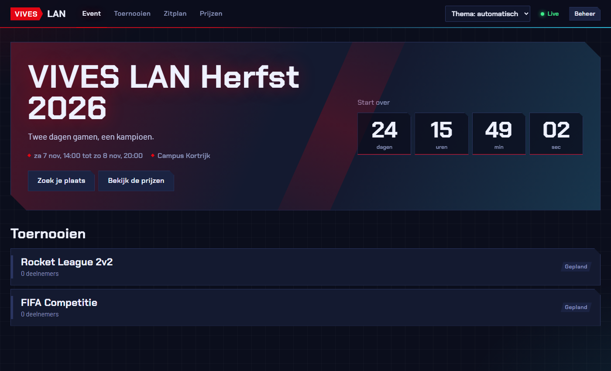 |

- **Per event:** bij Beheer → Events kies je een thema. Dat thema toont de site standaard bij dat event.
- **Per bezoeker:** in de topbar staat een themakeuze. *Automatisch* volgt het event, een eigen keuze wint en wordt onthouden in de browser.
- **Eigen thema's:** zet een map in [`custom-themes/`](custom-themes/) met `theme.json`, `theme.css` en een map `sprites/`. Het thema staat meteen in de lijst, zonder herstart of herbouw. Uitleg en een voorbeeld staan in [`custom-themes/README.md`](custom-themes/README.md).
- Wie "minder beweging" aan heeft staan in het besturingssysteem, ziet geen zwevende sprites.

---

## Events (LAN-edities)

Elke editie (bv. *"Herfst LAN 2026"*) heeft eigen toernooien, zitplan, prijzen en **spelers**.
**Games, teams en templates zijn gedeeld**, zodat je ze niet telkens opnieuw invoert.
Een team is niet aan één game gebonden en kan in elk toernooi meedoen.

| Onderwerp | Hoe het werkt |
|---|---|
| Actief event | Er is altijd één actief event: dat toont de publieke site met een aftelling tot de start |
| Oude edities | Bezoekers bekijken ze via de keuzelijst bovenaan |
| Beheer | Bovenaan kies je aan welk event je werkt |
| Eerste event | Neemt alle bestaande toernooien, plaatsen en prijzen over |
| Verwijderen | Een event met inhoud kan niet per ongeluk verwijderd worden |

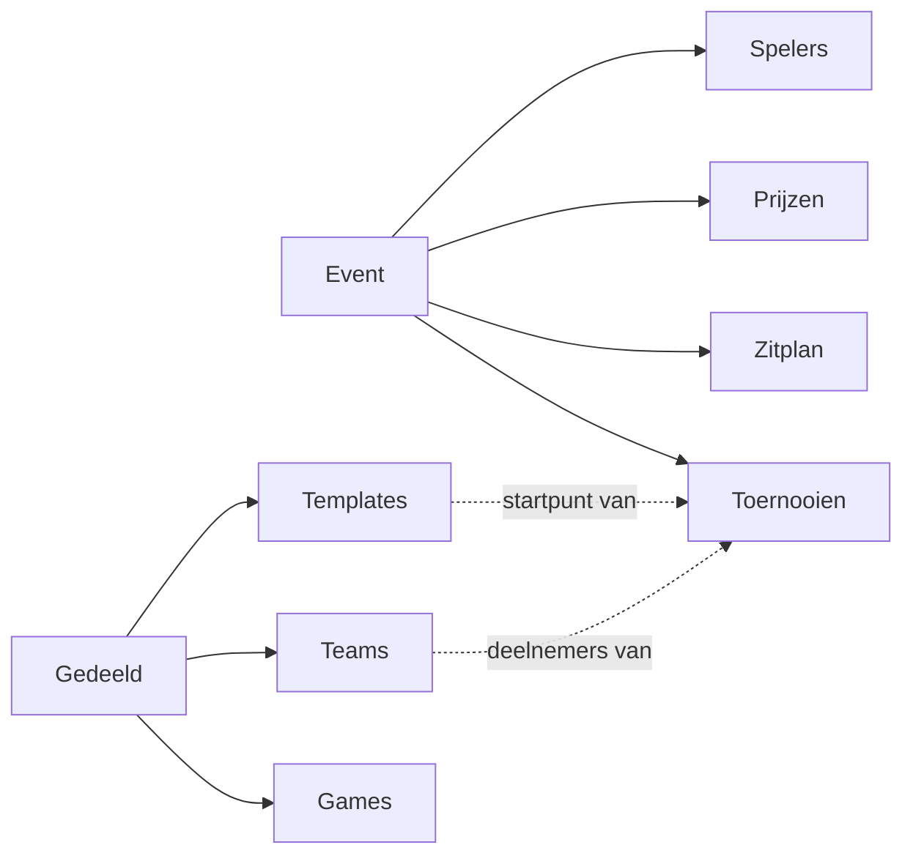

---

## Toernooivormen

| Vorm | Wat |
|---|---|
| Single elimination | Knock-out, byes automatisch, optionele kleine finale |
| Double elimination | Winners- en losers-bracket, grand final met optionele reset |
| Round robin | Iedereen tegen iedereen, heen/terug instelbaar, eigen puntensysteem |
| Poules + knock-out | Slangseeding in poules, daarna knock-out met de besten per poule |
| 🇨🇭 Swiss | Koppeling op punten zonder herkansingen, Buchholz als tiebreak |
| Puntentoernooi | Free-for-all (battle royale, racing): punten per plaats + bonus (kills) |
| Scorebord | Vrije punten: de admin kent zelf punten toe per criterium |
| LAN-ronde | Willekeurige groepen met een host, of één room voor de hele zaal; zie [LAN-rondes](#lan-rondes) |

Templates bewaren een vorm met instellingen (best of, puntentabel, aantal poules...). Bij een nieuw
toernooi kies je een template.

| Fase | Wat kan je aanpassen? |
|---|---|
| Voorbereiding | Instellingen, deelnemers en seeding |
| Gestart | Namen van deelnemers; uitslagen corrigeren zolang de volgende match niet gespeeld is |
| Afgelopen | Uitslagen corrigeren of het toernooi terugzetten naar de voorbereiding |

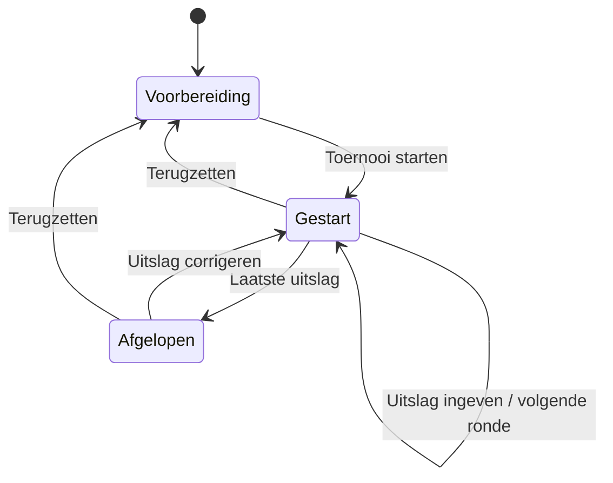

### Scorebord in detail

Voor alles wat geen wedstrijd is: social media-acties, aanwezigheid, bonusopdrachten...

| Onderdeel | Uitleg |
|---|---|
| Criteria | Bv. *Social gelikt* (5 punten per eenheid) of *Social gevolgd* (3 punten, max. 1) |
| Aantal | Per deelnemer geef je het aantal in; het portaal rekent aantal × punten per eenheid uit |
| Maximum | Kapt het aantal af, zodat niemand eindeloos punten kan sprokkelen |
| Aanpasbaar | Criteria wijzig je altijd, ook tijdens het toernooi. Verwijderde criteria wissen hun punten |
| Publiek | Klassement met een kolom per criterium |
| Afsluiten | **Toernooi afsluiten** en **Heropenen** |
| Startcriteria | In de template als `naam=punten; naam=punten` |

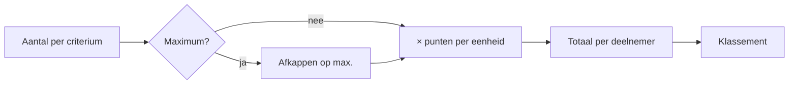

### LAN-rondes

Voor een avond met meerdere korte rondes waarin iedereen meespeelt. Eén ronde = één toernooi met de vorm
**LAN-ronde** (`lan-round`). Het aantal spelers is vrij: de groepen worden zo gelijk mogelijk verdeeld.

| Onderdeel | Uitleg |
|---|---|
| Soort ronde | **Groepen** (max. spelers per groep instelbaar, standaard 8) of **zaal** (iedereen speelt tegelijk) |
| Indeling | Willekeurig, of op stand (beste spelers samen, bv. voor een finale) |
| Host | Elke groep heeft een host die de room maakt, de roominfo invult en de uitslag instuurt. Wie al host was, wordt bij voorkeur niet opnieuw gekozen |
| Dubbele controle | De rest van de groep drukt **OK** of **Melden**. Alles OK = bevestigd, een melding = betwist (de crew beslist). Zonder melding bevestigt de uitslag na `autoConfirmSeconds` vanzelf |
| Punten | Groepen: tabel per groepsgrootte (`pointsBySize`). Zaal: rangbanden (`rankBands`). Bij twee matches telt de som van de plaatsen |
| Voorlopig | Punten tellen mee zodra de uitslag is ingestuurd, maar zijn voorlopig tot de bevestiging |
| Anti screen-peek | Groepsleden zitten bij voorkeur niet naast of tegenover elkaar (vereist tafels in het zitplan) |
| Bewijs | De host kan bij een uitslag een link naar een screenshot meegeven; het portaal slaat zelf geen bestanden op |
| No-shows | Een afwezige speler verwijder je uit de groep, zonder herschudden |
| Plan B | Werkt een zaalronde niet, dan zet de crew ze om naar groepen |
| Klassement | Het algemeen klassement telt alle rondes met *Telt mee in algemeen klassement*, plus de scoreboard-toernooien van het event als bonus |

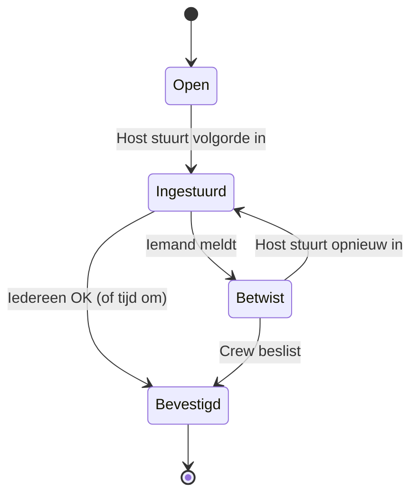

Alle acties lopen via `POST /api/tournaments/:id/matches/:actie/result`; spelers gebruiken hun eigen routes
onder `/api/rounds/me/...`, die enkel hun eigen groep raken.

Een uitgebreide handleiding voor de avond zelf staat in [`docs/crew-handleiding.md`](docs/crew-handleiding.md).

### Een LAN inrichten met een preset

Alles kan in de admin, maar voor een vast programma is er een optionele **preset**: een kant-en-klaar event met games en toernooien.

```bash
npm run seed:preset                          # toont de beschikbare presets
npm run seed:preset -- ieee-halloween-2026   # laadt een preset
docker compose exec app node src/presets/seedPreset.js ieee-halloween-2026
```

Het is veilig om opnieuw te draaien: wat al bestaat blijft ongemoeid. Een eigen preset maak je als map in `src/presets/` en registreer je in `src/presets/index.js`.

---

## Plugins

Onder **Beheer → Plugins**. Per plugin kies je aan/uit en welke meldingen hij stuurt:
event actief, toernooi gestart, elke uitslag, winnaar.

| Plugin | Wat doet ze? | Instellen |
|---|---|---|
| Discord | Post embeds in een kanaal via een webhook, geen bot nodig. Mentions staan uit | Kanaalinstellingen → Integraties → Webhooks → Nieuwe webhook → URL kopiëren. Zet `PUBLIC_URL` in `.env` voor correcte links |
| Algemene webhook | Elke melding als JSON naar een eigen URL (eigen bot, n8n, Home Assistant...) | Optioneel ondertekend met HMAC-SHA256 in `X-Lan-Signature` |

Webhook-URL's en geheimen gaan nooit terug naar de browser. Een event krijgt ook een Discord-uitnodiging
die als knop op de publieke site verschijnt.

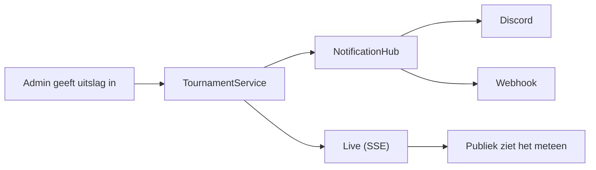

---

## Structuur

Het project is opgedeeld per domein (feature), niet per technisch type: alles wat bij toernooien hoort,
staat in één map. De Container in `src/app/` koppelt de services aan elkaar (dependency injection).

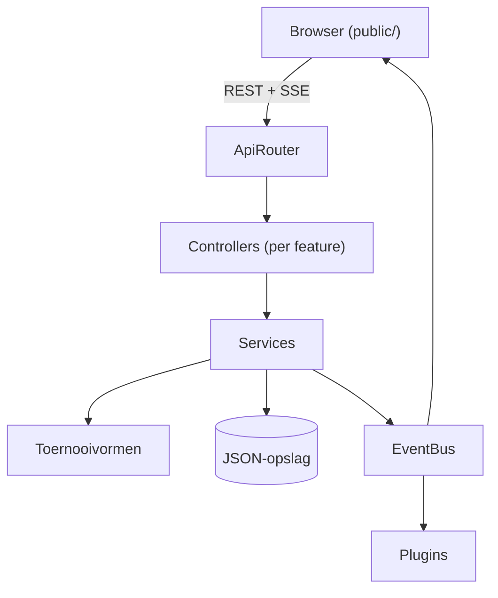

### Backend (`src/`)

| Map | Verantwoordelijkheid | Hangt af van |
|---|---|---|
| `server.js` | Startpunt van de app | `app/` |
| `app/` | Container (dependency injection), Express-app en `ApiRouter` | alle features |
| `core/` | Opslag, validatie, generieke CRUD, live-events (SSE), HTTP-fouten | niets |
| `features/auth/`, `admins/` | Aanmelden en adminbeheer | `core/` |
| `features/events/` | LAN-edities; bundelt toernooien, plaatsen en prijzen | `core/`, `themes/` |
| `features/themes/` | Leest thema-mappen van schijf (ingebouwd en eigen) en levert de lijst | niets |
| `features/games/`, `teams/` | Gedeelde basisgegevens | `core/` |
| `features/players/` | Spelers per event: gamertag-regels, CSV-import, check-in | `core/` |
| `features/player-auth/` | Speler-sessie zonder wachtwoord (gamertag kiezen) | `players/` |
| `features/rounds/` | "Mijn ronde": de eigen groep van een speler en zijn acties | `tournaments/`, `players/` |
| `features/leaderboard/` | Algemeen klassement en indelingsgegevens (stand, hosts, tafels) | `tournaments/`, `players/`, `seats/` |
| `presets/` | Optionele kant-en-klare inrichtingen van een LAN | alle features |
| `features/templates/` | Voorgedefinieerde toernooi-instellingen | `tournaments/formats` |
| `features/tournaments/` | Toernooien en hun levensloop | `templates/`, `games/`, `events/` |
| `features/prizes/`, `seats/` | Prijzen en zitplan | `core/`, `players/` |
| `features/plugins/` | Meldingen naar Discord en webhooks | `core/events` |

### Toernooivormen (`src/features/tournaments/formats/`)

| Map | Vormen |
|---|---|
| `elimination/` | Single en double elimination |
| `league/` | Round robin, poules + knock-out, Swiss |
| `points/` | Puntentoernooi (free-for-all) |
| `scoreboard/` | Scorebord met vrije criteria |
| `lan/` | LAN-ronde: groepen, controle van uitslagen, rangbanden, anti screen-peek |
| `shared/` | Gedeelde bouwstenen: klassementstabel, match-factory, constanten |

`TournamentFormat.js` is de abstracte basisklasse en `FormatRegistry.js` houdt alle vormen bij.

### Frontend (`public/`)

Geen buildstap: gewone ES-modules die de browser rechtstreeks laadt.

| Map | Inhoud |
|---|---|
| `css/` | Basisstijl met alle kleurvariabelen (= thema VIVES) en de sprite-animatiemotor |
| `themes/` | Ingebouwde thema's: `<id>/theme.json`, `theme.css`, `sprites/` |
| `fonts/` | Chakra Petch en Barlow, lokaal gehost (OFL-licentie) |
| `js/core/` | DOM-helper, API-client, router, live-verbinding, formulieren, modals |
| `js/views/` | Gedeelde weergaves: bracket, klassement, zitplan, prijzen |
| `js/public/` | Publieke pagina's, met `play/` voor "Mijn ronde" |
| `js/admin/` | Beheerpagina's, met `resources/` voor de configuratie per entiteit, `players/` (import, check-in) en `tournaments/lan/` (groepenbord) |
| `js/themes/` | Themakeuze, thema toepassen en de sprite-laag |

### Overig

| Pad | Inhoud |
|---|---|
| `tests/` | Tests voor de toernooi-engine, LAN-rondes, spelers, klassement, zitplan, events/thema's en plugins |
| `docs/crew-handleiding.md` | Handleiding voor de crew op de avond zelf |
| `custom-themes/` | Eigen thema's (docker-koppeling), met uitleg en een voorbeeld |
| `docs/screenshots/` | Screenshots voor deze README |
| `Dockerfile`, `docker-compose.yml` | Containerisatie met een volume voor de data |

### Uitbreiden

| Wat toevoegen? | Backend | Frontend |
|---|---|---|
| Toernooivorm | Klasse die `TournamentFormat` uitbreidt (`key`, `label`, `settingsFields`, `create`, `report`, `standings`, eventueel `advance`/`canAdvance`) en registreren in `FormatRegistry.defaults()` | Instellingen verschijnen vanzelf in het template-formulier |
| Nieuw soort item | Service die `CrudService` uitbreidt met een `Schema`, plus één regel in `ApiRouter` | Resource-config in `public/js/admin/resources/` en één route in `admin/main.js` |
| Plugin | Klasse die `Plugin` uitbreidt (`ownFields`, `send(message, settings)`) in `src/features/plugins/` en registreren in `PluginRegistry` | Instellingenformulier verschijnt vanzelf |

---

## API (kort)

Alle `GET`-routes zijn publiek (gevoelige velden zoals e-mail worden verborgen), schrijven vereist een admin.

| Route | Doel |
|---|---|
| `POST /api/auth/login`, `POST /api/auth/logout`, `GET /api/auth/me` | Aanmelden |
| `/api/games`, `/players`, `/teams`, `/prizes`, `/seats`, `/templates` | CRUD |
| `POST /api/players/import`, `POST /api/players/:id/release`, `DELETE /api/players?eventId=` | Import (CSV-rijen), naam vrijgeven, alle spelers van een event wissen |
| `GET /api/player-auth/available`, `POST /api/player-auth/claim`, `GET /api/player-auth/me` | Speler kiest zijn gamertag |
| `GET /api/rounds/me` en acties onder `/api/rounds/me/...` | Mijn ronde (speler) |
| `GET /api/leaderboard` | Algemeen klassement |
| `POST /api/seats/:id/claim`, `POST /api/seats/release` | Speler kiest of verlaat zijn plaats |
| `POST /api/seats/grid` | Zone als raster aanmaken |
| `GET /api/templates/formats` | Beschikbare vormen en hun instellingen |
| `/api/tournaments` | CRUD, plus `PUT /:id/participants`, `POST /:id/start`, `POST /:id/advance`, `POST /:id/reset`, `GET /:id/standings` |
| `POST /api/tournaments/:id/matches/:matchId/result` | Uitslag ingeven. Bij een scorebord is `matchId` de actie: `scores`, `criteria` of `status` |
| `/api/events` | CRUD, plus `GET /current` en `POST /:id/activate` |
| `/api/plugins` (admin) | `GET`, `PUT /:key`, `POST /:key/test` |
| `GET /api/live` | Server-Sent Events bij elke wijziging |

Lijsten van toernooien, plaatsen en prijzen filter je met `?eventId=...`.

---

<div align="center">

Gemaakt voor LAN-party's · Veel plezier en **GG!**

</div>
