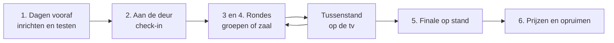
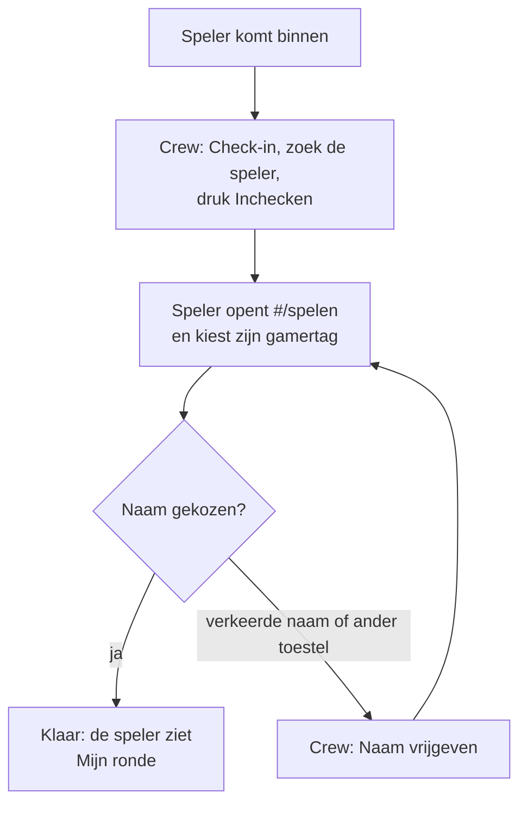
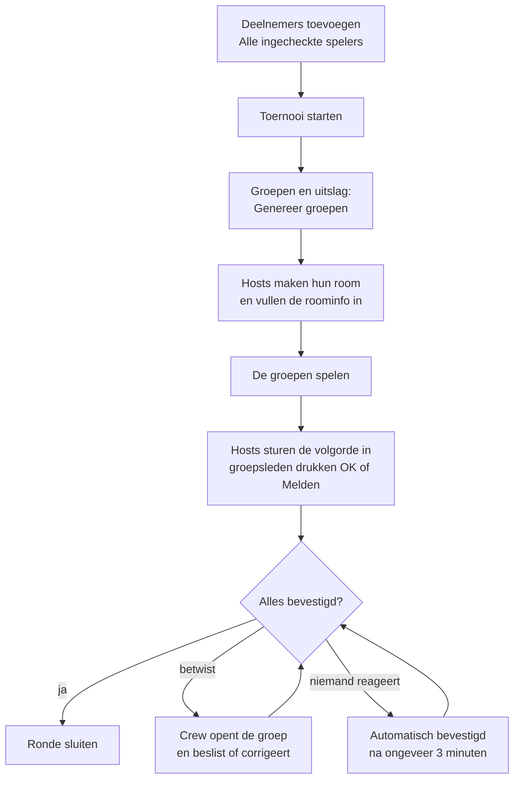
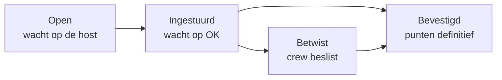
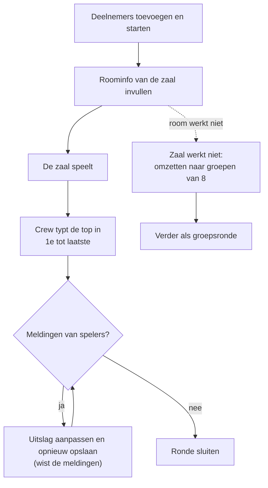
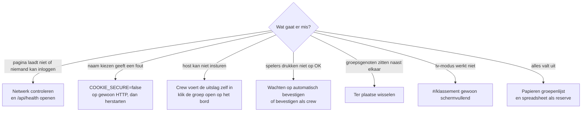

# Crew-handleiding: een LAN-avond met rondes

Voor de crew die de avond draait. Het portaal werkt met **rondes**: elke ronde is één game, gespeeld in groepen of
met de hele zaal tegelijk. Spelers volgen alles op hun eigen telefoon of laptop, de tv's tonen het klassement.

> Adressen hieronder: `http://<server>:3000` voor spelers en tv's, `http://<server>:3000/admin` voor de crew.

## 1. Dagen vooraf

| Wat | Hoe |
|---|---|
| Server | `docker compose up -d --build`. Op een LAN zonder HTTPS: `COOKIE_SECURE=false` in `.env` |
| Event | Beheer → Events: naam, startdatum, locatie, thema. Zet het op **actief** |
| Inrichting | In de admin, of met een preset (`npm run seed:preset -- <id>`). Een preset is optioneel |
| Games | Beheer → Games: per game de **host-kaart** (stappen en roominstellingen; een `*` vooraan een instelling markeert een afwijking van de standaard), hoe spelers binnenkomen en of spelers een eigen naam in het spel hebben |
| Rondes | Per ronde een toernooi met het template *LAN Groepsronde*, *Groepsronde (2 matches)*, *Zaalronde* of *Finale op stand*. Vul **ronde-nummer**, **starttijd** en **Telt mee in algemeen klassement** in |
| Social bonus | Een toernooi met het template *LAN Social bonus*; dat telt niet als ronde maar tikt wel mee in het klassement |
| Zitplan | Beheer → Zitplan → Zone toevoegen. Vul **plaatsen per tafel** in voor tafels met twee kanten. Spelers kiezen zelf hun plaats |
| Spelers | Spelers → Importeren (de `.xlsx` van Microsoft Forms kan rechtstreeks, of een `.csv`). Controleer de voorbeeldtabel: dubbele of ongeldige gamertags los je daar op |
| Testen | Test elke game vooraf. De checklist per game staat in de admin (veld *Testen voor de start*) |
| Back-up | Kopieer de map `data/` na elke ronde |

## 2. Aan de deur: check-in

1. Open **Check-in** in het beheer. Zoek op gamertag of naam en druk **Inchecken**.
2. Spelers openen `http://<server>:3000/#/spelen` en kiezen hun gamertag. **Wie eerst kiest, wint**: niemand kan later nog als iemand anders handelen.
3. Verkeerde naam gekozen, ander toestel of kapotte laptop? Druk bij die speler op **Naam vrijgeven**. Het oude toestel verliest de koppeling.
4. Zet op de tv's `http://<server>:3000/#/klassement?tv=1` schermvullend.

## 3. Een groepsronde draaien

1. Open het toernooi → tab **Deelnemers** → **Alle … ingecheckte spelers toevoegen** → **Deelnemers opslaan**.
2. **Toernooi starten**. Vink geen willekeurige seeding aan; die heeft hier geen effect.
3. Tab **Groepen en uitslag** → **Genereer groepen**. Elke groep krijgt een host. Staat er een melding over koppels die nog naast elkaar zitten, wissel dan ter plaatse of genereer opnieuw (kan zolang er geen uitslag is).
4. Spelers zien onder **Mijn ronde** hun groep, de host, hun plaats en de roominfo. De host ziet zijn **host-kaart**.
5. De host maakt de room, vult de roominfo in en stuurt na afloop de volgorde in (tikken van 1e naar laatste), eventueel met een link naar een screenshot als bewijs.
6. De anderen drukken **OK** of **Melden**. Alles OK = bevestigd. Zonder melding bevestigt de uitslag vanzelf na de ingestelde tijd (standaard 3 minuten).
7. Op het bord staan vier kolommen: **Open, Ingestuurd, Bevestigd, Betwist**. Klik een groep open om:
   - de uitslag zelf in te voeren of te corrigeren (dat bevestigt meteen),
   - een betwiste of ingestuurde uitslag te bevestigen,
   - de host te wisselen of de roominfo aan te passen,
   - een **no-show** te verwijderen (de groepen worden niet herschud),
   - bij twee matches een gelijke stand te beslissen.
8. Zijn alle uitslagen bevestigd: **Ronde sluiten**. Heropenen kan.

Wat je op het bord ziet:

## 4. Een zaalronde draaien

1. Deelnemers toevoegen en starten zoals hierboven. Het tabblad **Groepen en uitslag** toont nu het zaalpaneel.
2. Vul de **roominfo** in (code, link, wachtwoord). Die staat op de pagina van het toernooi voor de tv's en onder **Mijn ronde**.
3. Na afloop typ je de top in van 1e naar laatste (gamertag typen, Enter). Wie niet vermeld is, krijgt de punten van "rest".
4. Spelers kunnen **Mijn plaats klopt niet** melden. Pas de uitslag aan en sla hem opnieuw op: dat wist de meldingen. Daarna **Ronde sluiten**.
5. **Werkt de room niet?** Gebruik *Zaal werkt niet: omzetten naar groepen van 8* (kan zolang er geen zaaluitslag is).

## 5. De finale op stand

Gebruik het template *Finale op stand*. Bij **Genereer groepen** worden de groepen op het klassement gemaakt: de beste spelers samen in groep 1. Zitplaatsen worden hier niet gewisseld.

## 6. Klassement, prijzen en opruimen

| Wat | Hoe |
|---|---|
| Klassement | Totaal = som van de rondes + social bonus. Gelijke stand: beste enkele ronde, daarna de **tie-break plaats** (vul die in bij de speler, na bv. een 1-tegen-1) |
| Voorlopig | Een `*` of de melding "groepen nog niet bevestigd" betekent dat er punten uit onbevestigde uitslagen meetellen |
| Social | Open het social-toernooi: controleer de links en vink het platform af |
| Na afloop | Check-in → **Alle spelersgegevens wissen** (privacy; doe dit binnen een week) |

## 7. Als er iets misgaat

| Probleem | Oplossing |
|---|---|
| Spelers kunnen niet inloggen of de pagina laadt niet | Controleer het netwerk en `http://<server>:3000/api/health` |
| Telefoons geven een fout bij naam kiezen | Staat `COOKIE_SECURE=true` terwijl je op gewoon HTTP zit? Zet het op `false` en herstart |
| Host kan niet insturen | Voer de uitslag zelf in via het bord (klik de groep open) |
| Spelers drukken niet op OK | Wacht op automatisch bevestigen, of bevestig als crew |
| Iemand zit naast zijn groepsgenoot | Wissel ter plaatse |
| Tv-modus werkt niet | Gebruik `#/klassement` gewoon schermvullend |
| Alles valt uit | Papieren groepenlijst en een spreadsheet als reserve; maak die vooraf klaar |
